# buildings

A procedural building generator that derives form from **constraints** rather
than from taste.

Buildings of a place and a period look alike because they were built under the
same rules, not because their architects followed a style guide. Street width
capped the height. An ordinance capped how far a balcony could project and how
low it could hang. A decree fixed the shape of the roof above the cornice. What
we call "the Haussmann building" is the residue of those rules meeting a
programme.

**If you model the constraints, the style comes out for free — and it varies
correctly when the inputs vary.**

## What it does

You describe a *situation*, not a building:

```python
from buildings.site import SiteContext, BuildingClass, GroundProgramme
from buildings.typologies.paris.generate import generate

site = SiteContext(
    street_width=20.0,      # metres — handed down by the block
    parcel_width=12.0,
    parcel_depth=18.0,
    year=1865,
    klass=BuildingClass.COMFORTABLE,
    ground=GroundProgramme.SHOP,
    seed=7,
)
building, trace = generate(site)
```

There is no slider for roof angle, because nobody chose the roof angle. Widen
the street and the building gets taller *in steps*, because the rule was a step
table. Move the date past the 1884 decree and the roofline changes shape. Take
away the mezzanine and the balcony jumps up a floor by itself — because the
balcony rule is about height above the pavement, not about which floor it is.

Every element can name the rule that produced it:

```python
trace.explain(node.id)   # -> the ordinance, the reason, the inputs
```

## One engine, many styles

The generator began as Paris only. It is now a **split-grammar engine**
(`src/buildings/cga/`, in the manner of CGA, Müller and Wonka's *Computer
Generated Architecture*) and over thirty rulesets written on it. A building is a
tree of shapes: a lot holds a facade, the facade is split into storeys,
storeys into bays, a bay into its piers and its light, the light carries its
surround and keystone. Each shape has a scope, and rules either split it
(productions) or give it properties (layered attribute rules, the same
later-layer-wins, specificity-breaks-ties, a-tie-raises machinery Paris always
had).

**Changes stay where they are made.** The engine refuses a rule that writes
any shape but its own, and a part that strays outside the part it refines.
Overrides and changes of look can be addressed to one floor, one axis or one
building (`with_override`, `with_interpreter`). `dev/harness/cga_blast_radius.py`
applies such changes across hundreds of buildings and confirms each touched
only what it named.

**Styles are rule files.** Every ruleset is a TOML file beside its module:
`[[production]]` for how shapes split, `[[rule]]` for what they are given,
geometry and conditions as small expressions in a whitelisted language. Each
was checked byte for byte against the Python it replaced. The format is in
[dev/RULES.md](dev/RULES.md); the engine and the Paris port in
[dev/CGA.md](dev/CGA.md).

**Paris is unchanged.** The measured generator still produces exactly what it
did -- the grammar version of it is byte-identical on the fuzzer's 3000
situations (`dev/harness/cga_equivalence.py`) -- and its numbers are still
answerable to Daly. The other rulesets' numbers are INFERRED round figures
for their type and say so.

Every ruleset on one sheet (`python3 dev/harness/style_sheet.py`):

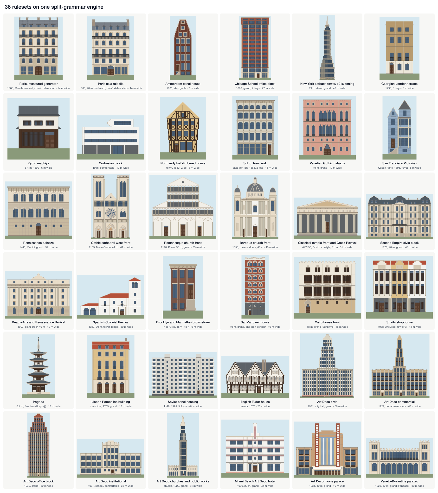

Six buildings from each ruleset, one scale per strip
(`python3 dev/harness/readme_strips.py` regenerates them):

**Paris, measured** — the original generator, answerable to Daly's plates: the 1783/1859/1884 height steps, the entresol, the noble floor, garrets and brisis windows in the mansard.

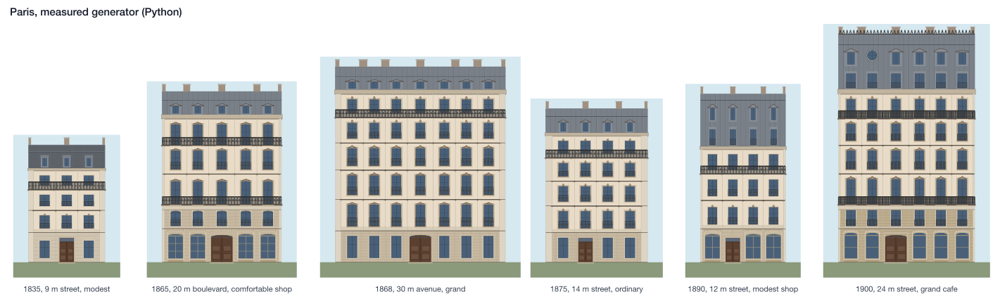

**Paris as a rule file** (`haussmann.toml`) — the same building written the way every other style is: decree step tables, class as ambition, tapering letting floors, square-headed ground-floor windows, and after 1884 a second row of roof windows. It agrees on shape and differs in detail; the stone never rises above the legal cornice.

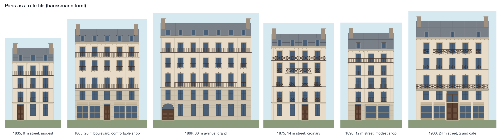

**Amsterdam canal house** — a narrow front of two or three bays over a half-sunk souterrain, with a stoop up to the door, rising into a gable that is a grammar of narrowing tiers. The outline follows the date: a step gable climbing in small steps, a one-window neck on low claw-piece shoulders, a bell, then a straight cornice.

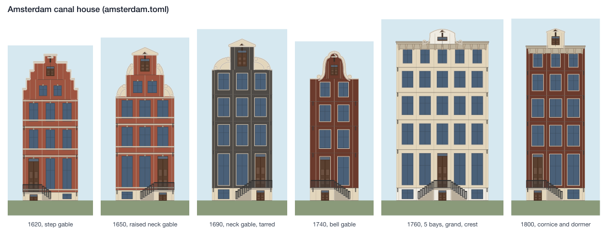

**Venetian Gothic palazzo** — every storey cut wing | centre | wing; the noble floors open in a polifora of ogee lights on colonnettes, never so many that an arch comes out under 0.95 m. The water gate is 2 to 3 m wide under a pointed arch, and a front shared by two brothers has one in each wing. Money sets the floor heights and adds a mezzanine over the water storey and a full third floor under the cornice; the family decides whether the second noble floor's windows get balconies.

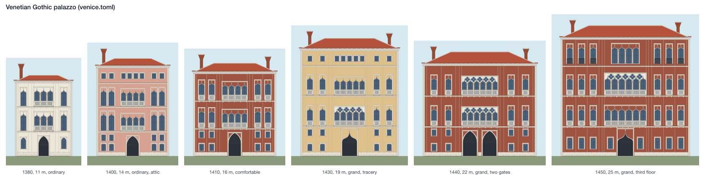

**Veneto-Byzantine palazzo** — the same rule file before 1300: the casa-fondaco, a portico of round arches across the water storey and an arcade of twice as many stilted arches above, and on a wide front two corner towers (torreselle) rising past the cornice, crenellated on the grandest (Fondaco dei Turchi).

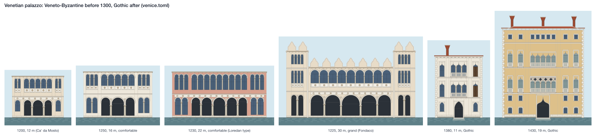

**Chicago School** — base, a shaft of identical floors, a capital; piers running the whole shaft. The architect (the seed) picks the skin (terracotta, white glazed, dark or red brick), the shaft window (Chicago 1:2:1, Wainwright pairs, three equal sashes) and the capital (arcade with roundels, plain attic band, or Sullivan's one arch a bay under oculi).

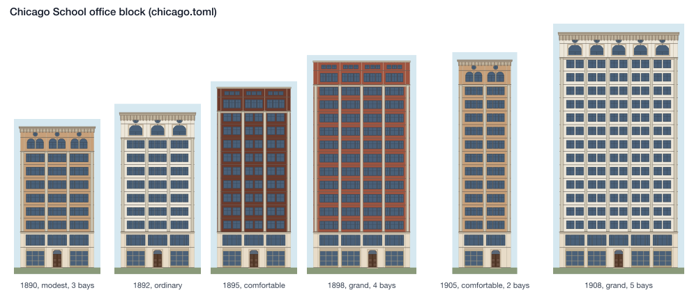

**New York setback tower** — the 1916 Zoning Resolution as rules: the street wall rises to a multiple of the street's width, tiers step back on the sky-exposure plane, the tower takes a quarter of the lot. The law fixes the envelope; the architect (the seed) picks the crown -- stepped spire, ziggurat, lantern, Chrysler's stepped arches, an Empire State mast, or a clock stage over terracotta or dark-granite piers (Eastern Columbia, Carbide & Carbon) -- the skin, and paired, strip or punched windows.

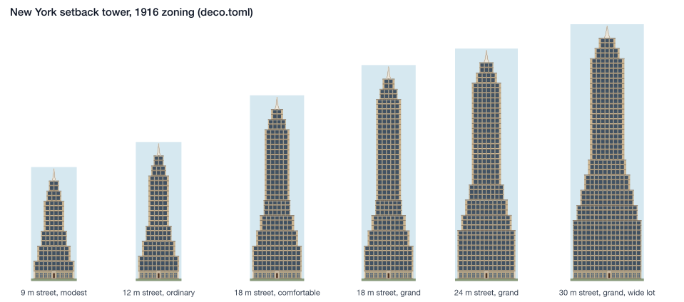

**The Art Deco family** — Art Deco as one vocabulary (glazing kinds, piers, spandrel plates, eyebrows, stripes, crests) shared by every programme, in `deco/vocabulary.toml`, with one rule file per programme beside it. The programme composes the front from blocks; four rule layers dress each block: the vocabulary, then the date (zigzag Deco to 1932, Streamline and PWA Moderne after), then the programme and part, then the architect's hand (the seed). Class sets the floors, the seed the stone. The civic rules follow the PWA courthouses (Outagamie, Raleigh, Winnebago, Galveston, Oklahoma County): a three-part block with a shallow raised centre, glass bands two or three storeys tall between piers with aluminium spandrels, a granite plinth and steps, a fluted portal, and a tower stage on the grandest.

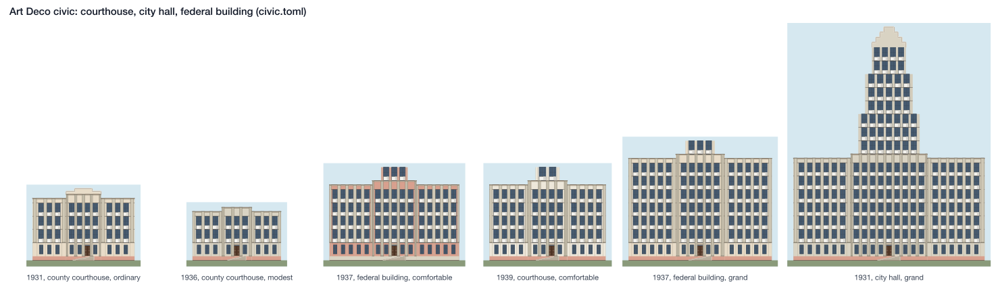

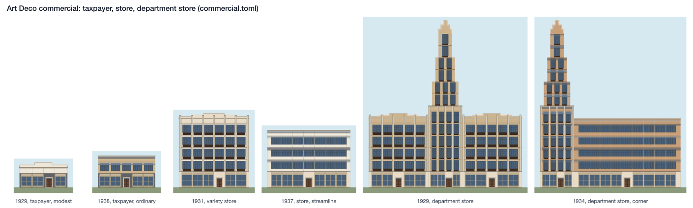

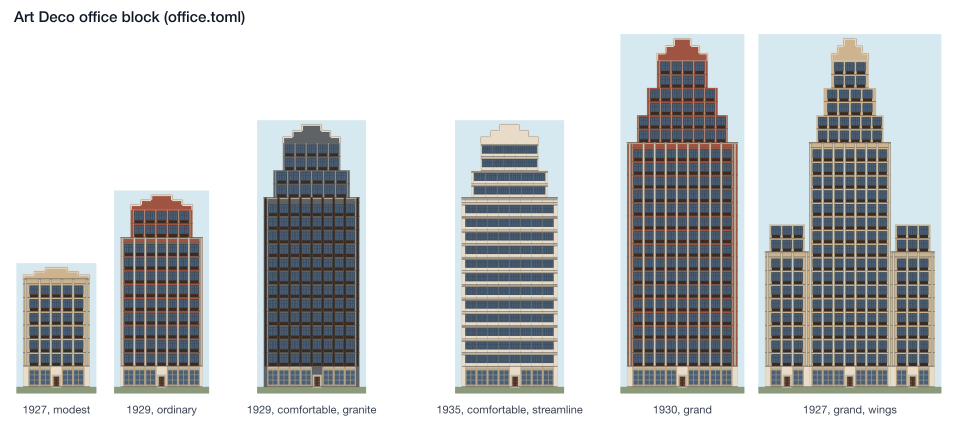

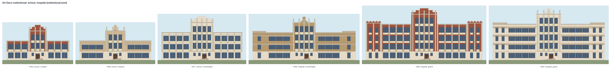

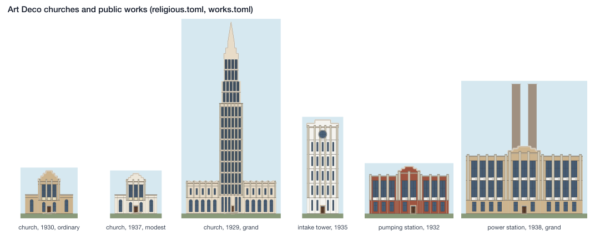

**Miami Beach hotel** — side | centre | side on the shared vocabulary, the centre raised in a fin carrying the name, an eyebrow over every window. The date turns Tropical Deco's stepped parapet and vertical fins into streamline racing stripes and portholes; a corner lot rounds its corner and the seed paints it.

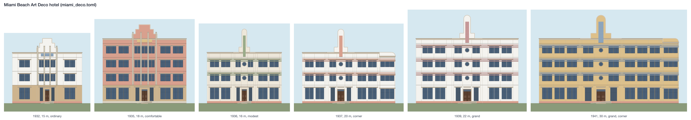

**Movie palace** — a bank of doors under a projecting marquee and a tall panel over them, with a lettered blade sign standing far above the parapet. The seed picks the panel (mosaic, flutes or glass) and the sign (centre, a pair, or the corner); a wider lot sets the front in a block of shops.

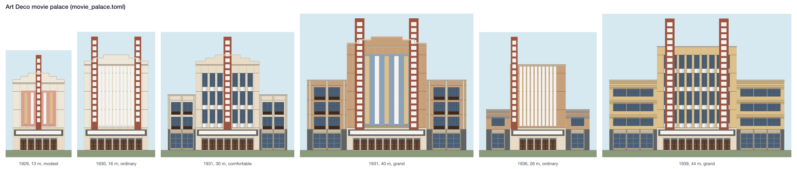

**SoHo** — the type comes from date and programme: Federal rowhouse, cast-iron loft (mostly glass, a column on every pier), brick store-and-loft with its fire escape.

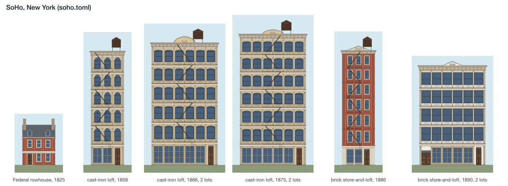

**San Francisco Victorian** — a bay-window zone beside an entry zone; how much of the bay its angled faces take separates the slanted Italianate from the square Stick; a Queen Anne gable and, on a grand house, a turret. The builder and the lot choose the layout: bay left or right, two bays round a central entry on a wide lot, a side yard behind a fence, an extra floor.

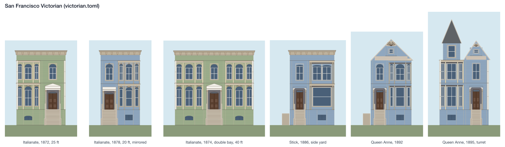

**Georgian London terrace** — every window one sash wide; its height is set by its floor's ratio, double square on the piano nobile, square at the top.

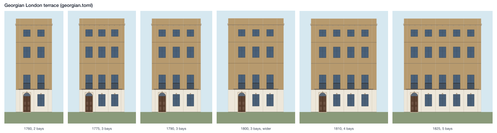

**Normandy half-timbering** — the frame is a grammar laid over the openings: posts at a spacing, never across a window, braces, Saint Andrew's crosses; jettied town houses and thatched country houses.

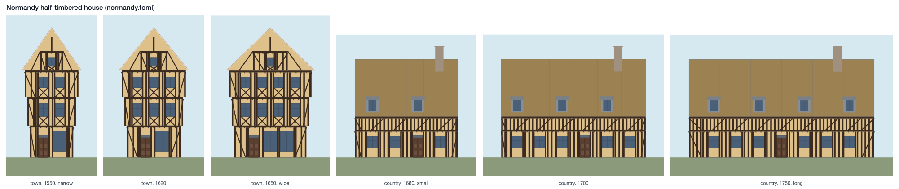

**Kyoto machiya** — a low loft over a timber ground floor, tiled pent roofs along the front, every opening screened by a lattice.

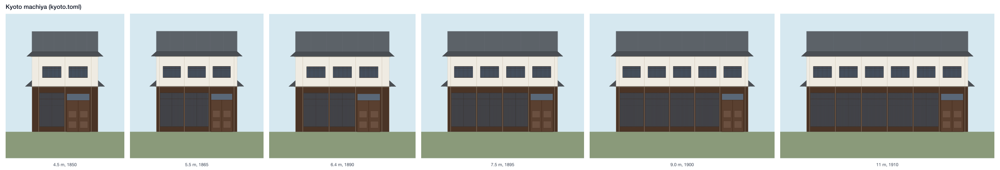

**Corbusian block** — pilotis on the structural grid and ribbon windows that deliberately ignore it: the free facade.

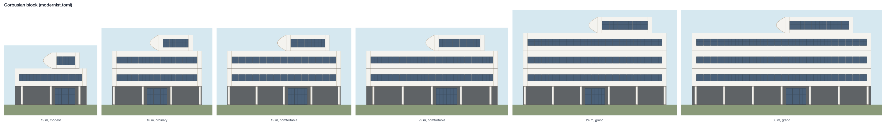

### Churches, temples and palaces

**Renaissance palazzo** — three storeys cut by one fitted rhythm under a crowning cornice. Before 1510 the architect (the seed) dresses the front as Rucellai (one order of pilasters a floor, paired arched lights), Medici (rustication graded rough to smooth as it climbs) or Strozzi (rusticated to the top); from 1510 it is the Roman Farnese: plain wall, rusticated quoins, aedicule windows with alternating pediments.

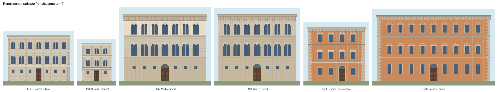

**Gothic cathedral west front** — a three-part screen between four buttresses: three portals of nested pointed rings, the central widest, the gallery of kings, a rose over the central portal, an open gallery, then twin towers and the nave gable. From 1220 the portals grow taller under gablets; money sets the rings and the tower height; the seed ends the towers flat, pinnacled, spired, or with a single spire.

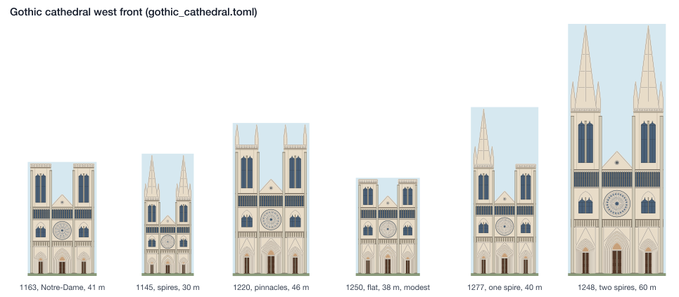

**Romanesque church front** — round arches stacked in tiers: either a Pisan screen of blind arcading under one to four open galleries, or a fortress front of two towers whose openings widen from a slit to a trifora as they climb, under battlements or helm roofs.

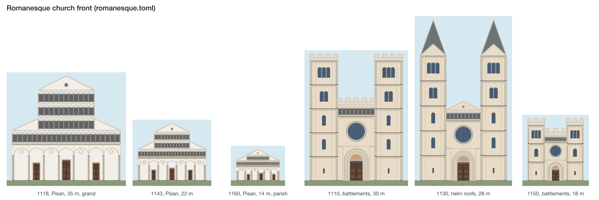

**Baroque church front** — a wide lower order and a narrower upper one joined by volutes under a pediment, each cut into planes that step forward to the centre, pilasters on the back planes and columns on the front. The date turns the flat Gesù into Santa Susanna's steps and then broken pediments; the seed can trade the volutes for twin bell towers, and a grand front shows its dome.

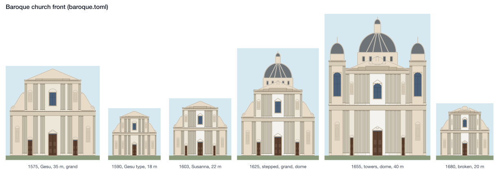

**Classical temple front and Greek Revival** — the order sets every proportion from the column diameter: spacing, column height, an entablature a quarter of the column, a 13–15° pediment. Before 1000 it is a temple, Greek on its steps or Roman on a podium; after, a Greek Revival custom house, all portico or a portico across a windowed block.

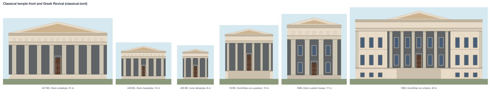

### American civic and row houses

**Second Empire** — the front is cut into ranges and pavilions by its length, every section on a rusticated basement with single or paired columns on each storey, under a mansard whose pavilions rise above the ranges in a convex, straight or concave curve; the date turns round heads to segmental to square.

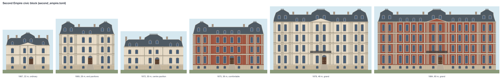

**Beaux-Arts and Renaissance Revival** — two grammars on one rusticated base: a palazzo that goes storey by storey under one heavy cornice, or a giant Corinthian order through two or three storeys between end pavilions, with an attic over the main cornice and, on a grand front, a sculpture group.

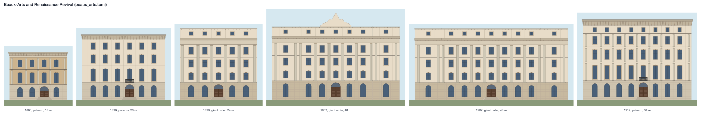

**Spanish Colonial Revival** — unequal masses (a bell tower, the main block, a low loggia wing) in white stucco under low hipped tile roofs, in the order the seed chose; arcades below, small grilled windows and iron balconies above, and a carved portal until the Depression plainens it.

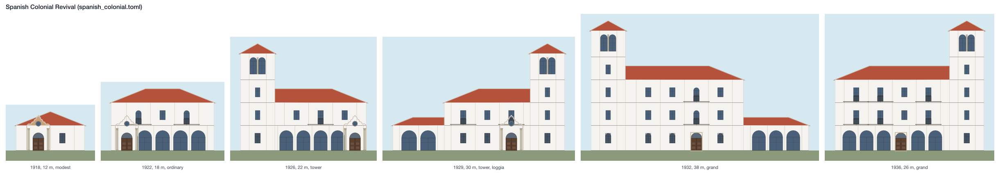

**Brooklyn brownstone** — every floor cut into the door's bay and the windows' zone, a stoop over the English basement to the parlour door. The date chooses the dress: Italianate hoods, Neo-Grec incised lintels, then Romanesque rock-face and round arches; a wide late lot swells into a bay front.

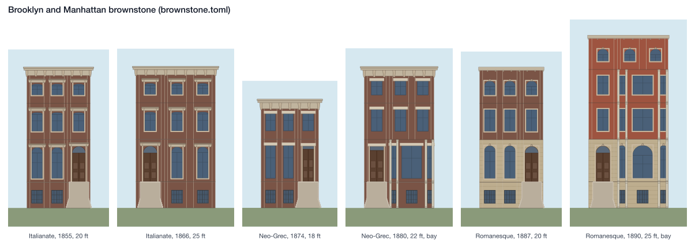

### Middle East and Asia

**Sana'a tower house** — dark stone storeys under brick ones, each standing on a white gypsum frieze, every window a light under its alabaster fanlight (qamariya), the top room under white merlons. Money adds storeys; the family (seed) picks single, paired or shared fanlights, a set-back top room, or a plain mud tower in the manner of Shibam.

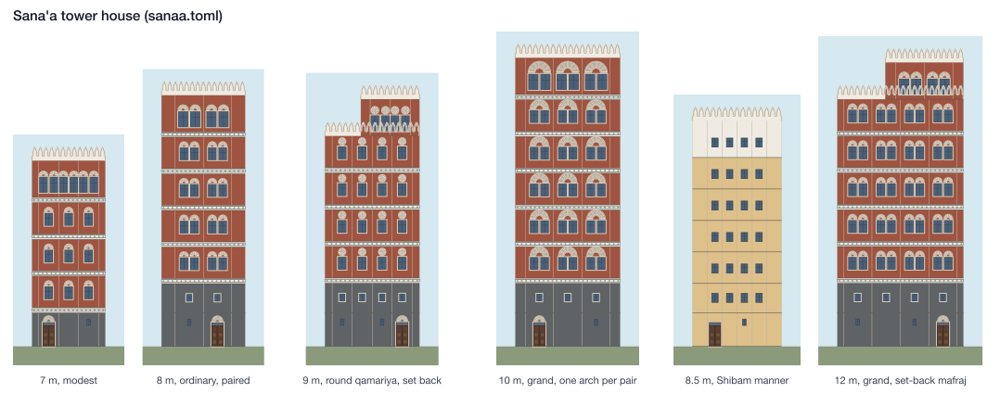

**Cairo house front** — a blind stone ground floor with a bent entrance under a muqarnas hood, upper floors on a timber beam with mashrabiya oriels on stepped corbels, and stepped merlons on top; the seed picks Cairo ashlar or Rashid brick, striped ablaq courses, and where the oriels hang.

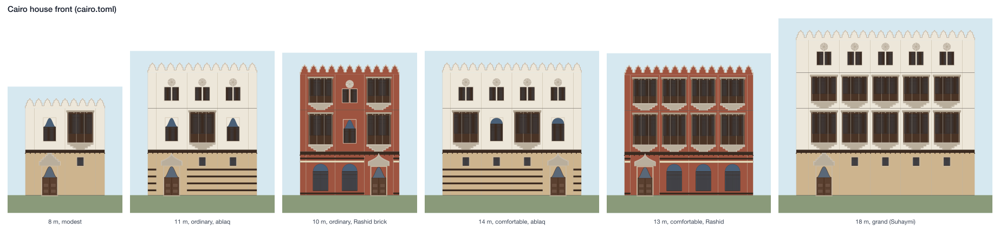

**Straits shophouse** — a row of narrow units, the shop set back behind the five-foot way between piers, tall shuttered windows above. The date picks one of six styles from Early to Early Modern, and with it the windows, pilasters, fanlights, eaves or parapet; money adds a storey and each owner paints his own unit.

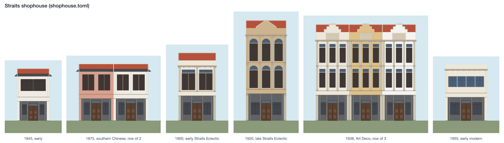

**Pagoda** — tiers on a stone podium, each narrower than the one below under its own roof: in the Japanese manner deep upturned eaves, railed balconies and a ringed finial; in the Chinese brick manner many tall tiers with shallow corbelled eaves. Size sets three, five or seven tiers.

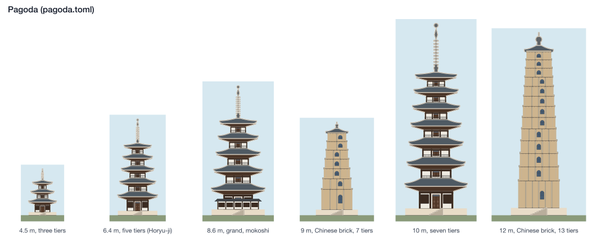

### Housing

**Lisbon Pombaline building** — the post-1755 standard elevation: the street's rank sets the floors and the balconies, and every window above the stone shop doors is one width on one rhythm, under a cornice and a tiled mansard; later owners clad the front in azulejos and raise it a floor.

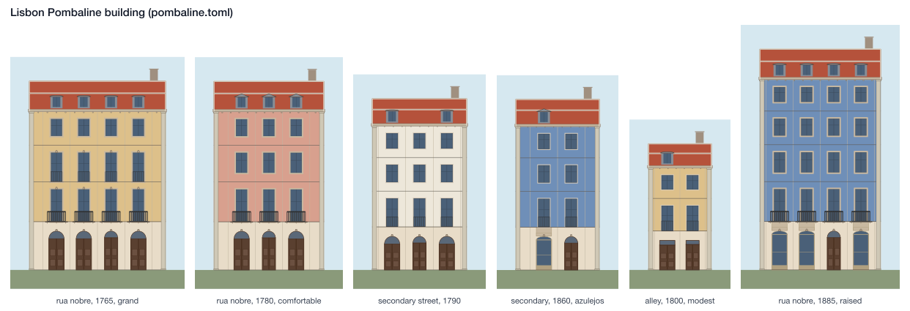

**Soviet panel housing** — a run of identical sections, every bay of every floor one factory panel, so the joints show. The date picks the series (K-7, 1-464, II-49, P-44) and with it the height, the lift room, balconies or loggias; the stair panels sit half a floor out of step over each entrance canopy.

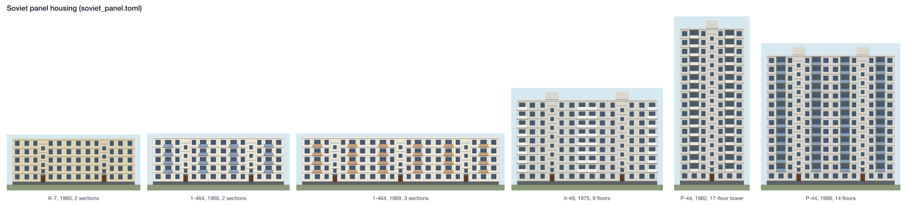

**English Tudor house** — black-and-white framing: close studding on a town house, square panels with lozenges on a manor or cottage, and every window a row of mullioned lights in diamond leaded panes. The town house is jettied under one or two steep gables, the manor cross-gabled as far as its money goes, the cottage under thatch; from the 1840s the Revival puts the frame over brick.

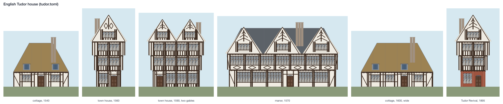

## Design

Four phases, each reading strictly backwards, never mutating what an earlier
phase read:

1. **Structure** — the fitting solver fills budgets with slots. Storeys into a
   height budget, bays into a width. Purely quantitative: no names, no meaning.
2. **Roles** — identity is *derived* by positional predicate, not declared. The
   principal floor is the tallest habitable slot above the base; you never say a
   building *has* one.
3. **Qualification** — rules map a read-only context to properties. "A balcony
   where the floor is at least 6 m above the pavement" is the actual 1823
   ordinance, expressed as a rule rather than a list of floor numbers.
4. **Composition** — rule sets layer: base vocabulary, period, class, site.
   Later layers win; specificity breaks ties.

Three things hold it together:

- **Every quantity carries its kind.** *Absolute* is set by the human body and
  never scales — a carriage entrance must admit a carriage. *Proportional* is
  compositional and scales with money. *Regulatory* is a number in a law and
  changes on a date. Conflating them is what makes procedural buildings look
  like toys: the grand building reads as grand precisely because its doorway is
  only a little bigger while its windows are much bigger.
- **Chronology is date windows on feature variants**, never a period enum on the
  building. Legality is a step function; fashion is a distribution. Availability
  depends on `(feature, year, class)`, because a feature reaches modest streets
  ten to twenty years after the boulevards — so a grand and a modest building
  both built in 1885 are not stylistic contemporaries.
- **The block is the unit, not the building.** The block owns frontage
  subdivision, adjacency, and the shared horizontal datums the 1855 circulaire
  required. Buildings *receive* those facts; they never sample them.

The output is a **structured description**, not a mesh. Renderers consume it. If
a renderer is deciding anything a person could argue about, that decision is in
the wrong place.

## The five invariants

Asserted by tests in `tests/invariant/`, not aspirations. Each has a named test
that must exist and pass. Stated once here and once in `dev/PLAN.md`.

| # | Invariant | Enforced by |
|---|---|---|
| **I1** | Phases read strictly backwards; no phase mutates what an earlier phase read | Frozen dataclasses, `test_phase_isolation` |
| **I2** | A building never samples a block-level fact — it *receives* it | `SiteContext` holds no RNG, `test_no_block_sampling` |
| **I3** | Every quantity carries its kind (absolute / proportional / regulatory) | `Quantity` newtype, `test_quantity_kinds` |
| **I4** | Every emitted element records the rule that produced it | `Node.trace` non-empty, `test_trace_completeness` |
| **I5** | Seed + situation ⇒ identical output, always | `test_determinism`, fuzz harness |

Three standing guards back them, run as scripts rather than tests so they can
be pointed at the tree from anywhere:

```bash
python3 dev/harness/check_ir_is_consumed.py        # nothing emitted is ignored downstream
python3 dev/harness/check_no_period_branching.py   # no `if period ==` anywhere
python3 dev/harness/check_renderer_dumb.py         # the renderer decides nothing arguable
```

## The construction ladder

Phase 1 fills an exact budget with typed slots — storeys into a height budget,
bays into a width. One generic 1-D solver serves both axes and knows nothing
about Paris (`src/buildings/solver/fitting.py`).

**The vocabulary.** Count **axes**, measure **pitch**. An *axis* is the vertical
line of openings up the facade — the thing you count. *Pitch* is axis to axis,
centre to centre. Each pitch is filled by one **window** plus one **pier**, so
`window + pier = pitch` exactly. The solver's repeating module is measured
centreline-to-centreline of the filler — half-pier, opening, half-pier — which
is why `N` bays is *exactly* `N × pitch` and the only special case is the two
ends. (Avoid the word "bay" in prose: it names the solver's module, a vestigial
catalogue entry, and colloquially the opening itself.)

**Choosing the count.** The solver walks candidate counts outward from the one
that fills the budget most nearly, and takes the first the declared bounds
permit — closest to preferred, whether that means one more axis at a narrower
pitch or one fewer at a wider one. It does *not* floor the division. Flooring
discards up to a whole axis and then has to hide the remainder: on a 15.0 m
frontage with a carriage entrance it chose 3 axes and inflated every pitch to
3.367 m to absorb 2.5 m of slack, where 4 axes sit near the preferred pitch.

**Absorbing what is left.** Residue goes into the most elastic thing available,
and *that ordering is the solver*:

| rung | | absorbs by |
|---|---|---|
| 1 | `WIDEN_ENDS` | the two end piers — they exist to be adjusted |
| 2 | `WIDEN_FILLER` | the pier thickens; the opening does not move |
| 3 | `WIDEN_BAY` | the opening itself stretches — visible past a few percent |
| 4 | `INSERT_SPECIAL` | a narrow half-bay, blind panel or œil-de-bœuf |
| 5 | `ADD_MODULE` | one more axis |

`rigid=True` slots carry ABSOLUTE quantities and **never** absorb — a carriage
entrance must admit a carriage, and stretching a doorway to make the arithmetic
work is the move that destroys scale.

**An entrance is an opening in an ordinary axis, exactly like a window.** The
ABSOLUTE quantity is the *clear opening* — the body or the vehicle that has to
pass — not the strip of frontage around it. So a slot the solver is told to
place at an index may be declared a member of the repeating pool: it takes one
of the modules, at the pitch, and the masonry beside it then differs from the
masonry between two windows by exactly what the two openings differ by. The
opening plus a jamb either side is that slot's **minimum**, and where the pitch
falls under it the solver refuses and the caller re-solves with the slot given a
module of its own. That is the only exception, and it is conditioned on
**width** rather than on the slot being a door: at the 2.00–3.20 m band a
pedestrian door needs 2.35 m and effectively never triggers it, a carriage arch
needs 3.04 m and usually does. Before this, the entrance was the one rigid
element in an elastic run, and the wall next to the biggest hole in the facade
came out *thinner* than the wall between two windows.

Two placements are deliberate. `INSERT_SPECIAL` sits *below* `ADD_MODULE` and is
tried first: five good axes plus one narrow one reads better than six squeezed
ones, so the leftover is treated as architecturally meaningful rather than as
padding. And **parity belongs to the composition, not to one rung** — a central
feature means something stands *on* the axis, satisfied either by an odd
interior run or by an even one with a lone central special. Constrain only the
`ADD_MODULE` increment and the count still walks 1, 2, 3, 4 as the budget grows,
putting the axis on a pier half the time.

Since the count is chosen by closeness, **rung 5 is now reachable only where
parity forbids the closest count** — if one more axis were the better answer, it
is already the count that was chosen. The rung is subsumed, not removed, and the
ordering is unchanged.

**Known limit.** Every end pier is one width and every interior pier another:
`_absorb` returns two scalars. A facade whose piers vary — narrower toward the
middle, or the inverse — is not expressible. The seam for that change is
`_absorb`, the single place that decides where residue goes.

## Layout

```
src/buildings/
  quantity.py     absolute / proportional / regulatory kinds
  trace.py        which rule produced this element
  rng.py          addressable, decorrelated decision streams
  site.py         the situation
  ir/             node vocabulary + lossless serialisation
  solver/         the fitting solver and its absorption ladder
  cga/            the split-grammar engine: shapes, split/fit/insert, scoped
                  overrides, locality checks, the rule-file expression language
  typologies/
    paris/        the measured generator: reglement.py structure.py roles.py
                  chronology.py catalogue.py qualify/ compose.py terminate.py
                  generate.py; grammar.py (the same building on the engine);
                  haussmann.toml + rules.py (Paris as a rule file)
    common/       kit.py (window anatomy, IR writers), rulefile.py (the loader)
    amsterdam/ baroque/ beaux_arts/ brownstone/ cairo/ chicago/
    classical/ deco/ georgian/ gothic_cathedral/ kyoto/ miami_deco/
    modernist/ movie_palace/ normandy/ pagoda/ pombaline/ renaissance/
    romanesque/ sanaa/ second_empire/ shophouse/ soho/ soviet_panel/
    spanish_colonial/ tudor/ venice/ victorian/
                  each: <style>.toml (the rules) + grammar.py (site type,
                  named drawings, generate/derive)
  block/          frontage subdivision, adjacency, shared datums
  render/svg/     the renderer, which decides nothing arguable
tests/
  unit/  invariant/  oracle/
dev/              the plan, the harness, and the reference corpus
```

## Running

```bash
python3 -m pytest tests/ -q                          # the suite
python3 dev/harness/first_building.py                # one building, fully traced
python3 dev/harness/contact_sheets.py                # visual sweeps
python3 dev/harness/check_no_period_branching.py     # guard
python3 dev/harness/check_renderer_dumb.py           # guard
open dev/reference/review.html                       # reference corpus selection
python3 dev/harness/cga_equivalence.py               # the grammar builds what the pipeline builds
python3 dev/harness/cga_blast_radius.py              # local changes stay local
python3 dev/harness/readme_strips.py                 # the strips above
python3 dev/harness/soho_sheet.py OUT [--styles|--more|--sf-normandy|--paris]
```

Python 3.11+. No runtime dependencies.

## Scope

Paris, 1820–1902, is the measured typology: every number answerable to a
source. The other rulesets show the engine generalising, with
inferred proportions; calibrating any of them against measured plates would be
its own piece of work. Still not in scope: a general binding system for block
relation, a 3-D backend, or an override system separate from rule layering.

Interiors, structure, services and photoreal materials are out of scope
permanently. This does one vocabulary well.

See `dev/PLAN.md` for the stage sequence, `dev/CONTRACTS.md` for the interface
contract, and `dev/reference/SOURCES.md` for the primary sources every number is
answerable to.
